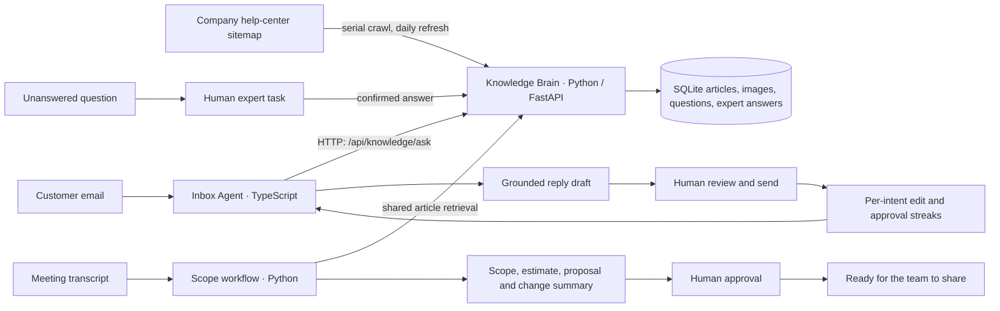

# Design notes

## The problem

Small software teams spend a lot of their time finding answers, responding to email, and writing down what a client already explained in a meeting. These are different jobs, but they depend on the same facts about the product. A shared knowledge service helps the team answer once and reuse the answer without copying product logic into each agent.

The first version favors a working, reviewable end-to-end path over a claim that an untested model is production-ready. It is a local demo with transparent sample content, persistent state, citations, and human review at decisions that can commit the business to money or policy.

## How the three tasks connect

The task boundary is explicit: the inbox gets facts through the Knowledge Brain HTTP API. The scope workflow is part of that same Python API and uses the same article lookup rather than maintaining a second index. The browser is a client of both services; it does not own business data.

## Why these features

- **An incremental sitemap sync** means existing URLs are compared by content hash. A full successful sync removes pages that disappeared; an incomplete crawl keeps old pages rather than risking a destructive partial refresh. Requests are serial, spaced by a configurable delay, bounded to 500 pages and 2 MB per page, and time out. The service retries the sitemap on its daily interval rather than holding a page-by-page checkpoint.
- **Sources on answers** make factual review possible. Low-confidence questions create a human task instead of a confident-sounding guess. Saving an expert's answer adds it to the shared search index.
- **Screenshots remain attached to their article.** When Claude is configured, the crawler can inspect public JPEG, PNG, GIF, or WebP screenshots and add a textual description to article retrieval. Without Claude, it preserves image URLs and alt text but cannot visually interpret an unlabelled screenshot.
- **A simulated inbox** gives the team realistic data without pretending to connect to customer mail. Replies can be edited, approved, and persisted. Twenty consecutive unchanged approvals per intent allow only low-risk intents to be marked auto-sent. An edit resets that intent's streak and disables its automation.
- **A structured scope draft** lists estimated hours, configuration opportunities, questions, risks, and a client-ready proposal. Follow-up drafts record added and removed items. Approval and requested changes remain internal events, not outbound actions.
- **A responsive dashboard** keeps the three jobs in one workspace while showing the sources, confidence, review status, and connection errors needed to make decisions.

## Models and evaluation choices

Claude is an optional provider behind one small Messages API adapter, selected through `ANTHROPIC_MODEL`. The checked-in default is `claude-sonnet-4-20250514`; it has not been benchmarked as part of this project. One model is wired, not compared. The local fallback is useful for running the product and exercising the workflow, not a competing language model. No accuracy, cost, speed, or production-quality figures are invented. Compare models against the same fixtures and record actual provider usage before choosing a production default; see [EVALS.md](./EVALS.md).

## Boundaries and risks

This is a single-operator development demo: the APIs do not authenticate users, authorize workspaces, or provide tenant isolation. SQLite and the inbox JSON store are for local use, not concurrent production deployment. There is no real mail provider, CRM integration, durable background queue, billing, or human-task notification. The daily sync requires the API process to remain running. Sitemap crawling is restricted to public hosts and basic page bounds, but a production crawler should also enforce robots and source-host policies, defend against DNS rebinding at connection time, and use a hardened isolated fetch service.

The keyword retriever is intentionally easy to inspect and test, but is not a vector database and may miss paraphrases. Seed articles are examples, not verified documentation from the vendor. Claude output is untrusted: human review remains necessary, especially for policy, pricing, security, and project estimates.

## What was dropped and what comes next

This build does not send email, scrape behind logins, extract tables or PDFs, run a real vector/graph database, or produce committed AI model-comparison results. Add these only with business approval, representative evaluation data, and clear ownership of customer records. Next: workspace authentication and tenant isolation; a durable, resumable crawler queue; embeddings and retrieval evaluation; real mail-provider integration in draft-only mode; change-aware scope editing; and a 20–30-case-per-model benchmark with measured quality, latency, and provider-reported cost.
